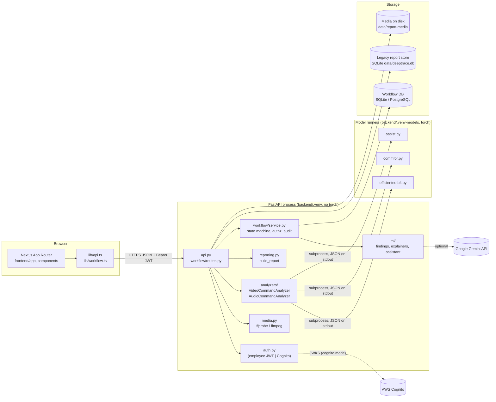

# Architecture

Extended local PoC additions: `analyzers/review_signals.py` invokes a separate descriptive-measurement runner; it never imports model libraries into the API or changes detector decisions. `ReviewCheck` records and audio coverage persist in existing ModelRun JSON metadata and are exposed in both report and workflow contracts. No columns or tables were added. See [POC_IMPLEMENTATION.md](POC_IMPLEMENTATION.md) for the opt-in launcher, failure reports and remaining scientific limits. New reports no longer label unrelated task-score differences as MODEL_DISAGREEMENT; old reports remain readable.

Current state of the repository. Model specifics are in [MODEL_REGISTRY.md](MODEL_REGISTRY.md); endpoint contracts in [API.md](API.md).

## System overview



Two independently deployable units: the static/standalone Next.js frontend (port 3000) and the FastAPI API (port 8000 locally, 8080 in its container). Docker Compose adds PostgreSQL 16. There are **no background workers or queues**; analysis runs synchronously inside the upload request.

## Layers and ownership

| Layer | Location | Responsibility | Must not |
| --- | --- | --- | --- |
| Pages / components | `frontend/app`, `frontend/components` | Rendering, local UI state, upload, playback, review UX | Enforce authorization; compute or reinterpret scores |
| API clients | `frontend/lib/api.ts`, `frontend/lib/workflow.ts` | Typed fetch wrappers, bearer header, `SESSION_EXPIRED` signalling | Hold business rules |
| Routes | `backend/deeptrace/api.py`, `workflow/routes.py` | HTTP parsing, `Depends(require_user)`, error mapping | Contain workflow rules (exception: `/v1/analyze` orchestration lives in `api.py`) |
| Auth | `backend/deeptrace/auth.py` | Issue/validate JWTs, resolve role | — |
| Media prep | `backend/deeptrace/media.py` | MIME allowlist, SHA-256, ffprobe metadata, frame + audio extraction | Run models |
| Detector adapters | `backend/deeptrace/analyzers/` | Invoke runner subprocess, validate JSON, build `ComponentResult`, apply 0.5 development rule for observations | Import torch; persist |
| Model runners | `backend/scripts/inference/` | Load checkpoint strictly, preprocess, infer, emit JSON | Know about HTTP, DB, or users |
| Reporting | `backend/deeptrace/reporting.py` | Summary, observations (`MODEL_DISAGREEMENT`, metadata warnings), methods, limitations | Fuse scores |
| Workflow service | `backend/deeptrace/workflow/service.py` | Persist screening, derive findings, status transitions, report revisions, audit events, authorization | — |
| ML post-processing | `backend/deeptrace/ml/` | `detection_from_component` (findings), explainer payload normalization, case assistant, evaluation math | Import torch; talk to HTTP |
| Persistence | `backend/deeptrace/db/`, `report_store.py` | Tables and sessions | — |

**Where things belong**

- Business/workflow logic → `workflow/service.py`.
- ML inference logic → `scripts/inference/*` (runner) + one adapter class in `analyzers/`.
- Score-to-finding mapping → `ml/detectors.py::detection_from_component`.
- API serialization → Pydantic `response_model`s in `schemas.py` / `workflow/schemas.py`; the workflow service returns plain dicts shaped by `_detail`, `_finding_out`, `_report_out`, etc.
- Persistence → `workflow/service.py` (SQLAlchemy session via `session_scope`/`get_session`) and `report_store.py` (raw `sqlite3`).

## End-to-end trace: video upload

1. **User** drops a file on `/detector` → `components/screening.tsx` `submit()` → `lib/api.ts::analyze()` posts multipart `file` to `POST /v1/analyze` with `Authorization: Bearer <token>` (token from `sessionStorage`). The progress UI is timer-driven; the request is a single blocking call.
2. **Route** `api.py::analyze` (requires `require_user`) streams the upload to `DEEPTRACE_UPLOAD_DIR` in 1 MB chunks, rejecting > `DEEPTRACE_MAX_UPLOAD_MB` with 413.
3. **Media** `media.extract_metadata` checks the declared MIME type against `ALLOWED_TYPES` (415 otherwise), hashes the bytes (SHA-256), probes with ffprobe (failures become `extraction_warnings`). `media.prepare_video` writes JPEGs at `fps=1/DEEPTRACE_FRAME_INTERVAL_SECONDS` capped at `DEEPTRACE_MAX_FRAMES`, plus a mono 16 kHz PCM WAV, into a temp dir.
4. **Detectors** run sequentially, each as a subprocess (`subprocess.run`, no shell, 900 s timeout):
   - face: `EfficientNetVideoAnalyzer` (or `EffortVideoAnalyzer` if `DEEPTRACE_VIDEO_MODEL=effort`) on the frames dir;
   - whole frame: `SceneVideoAnalyzer` (Community Forensics) on the same frames dir;
   - audio: `AASISTAudioAnalyzer` (or Nes2Net) on the extracted WAV.
   Each runner prints `{"model_version", "checkpoint", "samples"|"fake_probability", "notes", ...}`; the adapter validates it and returns a `ComponentResult` with `status` ∈ functional / unavailable / error / not_applicable.
5. **Report** `reporting.build_report` assembles an `AdvisoryReport` with `components=[face, scene, audio]`, `overall_synthetic_confidence=None`, an `evidence_summary`, observations, methods and limitations.
6. **Persistence**
   - `report_store.persist_media` copies the upload to `DEEPTRACE_REPORT_MEDIA_DIR/<report_id>/<filename>`.
   - `workflow.service.record_screening` creates `Analysis` (status `AI_SCREENING_COMPLETE`), `MediaFile`, one `ModelRun` per component, `Finding` rows via `ml.detectors.detection_from_component` (one per sample with `raw_score ≥ DEEPTRACE_DECISION_THRESHOLD`), `AttributionArtifact` per finding, a `Report` whose `ai_original` and `current_body` are the generated sections, an `ai_generated` `ReportRevision`, and audit events.
   - `report_store.save_report` stores the full `AdvisoryReport` JSON in the legacy SQLite DB.
7. **Response** returns the `AdvisoryReport` (with `analysis_id`). Temp upload and frames are deleted in `finally` unless `DEEPTRACE_KEEP_UPLOADS=true`.
8. **Render** `components/report.tsx::ReportView` shows one card per component ("Face manipulation", "AI-generated video", "Synthetic / spoofed speech") with "MODEL SCORE", the threshold-validation note, and frame timelines. "Open workspace" links to `/analyses/{analysis_id}`.
9. **Review** `components/analysis-workspace.tsx` loads `GET /v1/analyses/{id}`, `/report`, `/media` and renders findings, attribution (Grad-CAM crops, audio occlusion windows), comments, and the AI draft. Dispositions, comments, report edits, submission and supervisor actions go through `/v1/analyses/{id}/…` and mutate workflow DB state.

## Frontend ↔ backend state

- Backend is the source of truth. Pages fetch on mount (`useEffect` + `Promise.all`), keep results in component state, and patch local state from mutation responses. There is no client cache library or global store beyond `AuthProvider`.
- `AuthProvider` (`components/auth.tsx`) holds token and role in `sessionStorage`; any 401 surfaces as `Error('SESSION_EXPIRED')` and callers invoke `auth.expire()`.
- Two parallel representations of a screening exist: the legacy `Report` (`/v1/reports/{report_id}`) and the workflow `AnalysisDetail` (`/v1/analyses/{analysis_id}`). They are linked by `Analysis.legacy_report_id` / `AdvisoryReport.analysis_id`.

## Workflow state machine (workflow DB)

```text
AI_SCREENING_COMPLETE ─(disposition / comment / report edit)─▶ INVESTIGATOR_REVIEW
        │                                                         │
        └──────(disposition = needs_expert_review)────────────────┴─▶ EXPERT_REVIEW_REQUESTED
AI_SCREENING_COMPLETE | INVESTIGATOR_REVIEW | CHANGES_REQUESTED ─(submit)─▶ SUPERVISOR_REVIEW
SUPERVISOR_REVIEW ─(request-changes)─▶ CHANGES_REQUESTED
SUPERVISOR_REVIEW ─(finalize)─▶ FINALIZED
```

`UPLOADED` and `PROCESSING` exist as frontend labels but are never written by the backend (analysis is synchronous). No transition out of `EXPERT_REVIEW_REQUESTED` exists in the service today.

The legacy store has its own, separate status (`draft → submitted → in_review → reviewed`) driven by `/v1/reports/{id}/submit` and `/review/{start,complete}`.

## Auth and roles

- `DEEPTRACE_AUTH_ENABLED=false` (settings default): every request is `{"sub": "local-development", "role": "analyst"}`.
- `employee` mode: `POST /v1/auth/login` checks env-configured accounts (investigator=`analyst`, supervisor, reviewer, admin) with constant-time compare, then directory users in the `users` table (PBKDF2-SHA256, 200k iterations). Issues HS256 JWT (`iss=deeptrace`, `aud=deeptrace-frontend`).
- `cognito` mode: RS256 access tokens validated against the pool JWKS; role from `cognito:groups` (`supervisor` else `analyst`).
- `analyst` and `investigator` are the same canonical role (`workflow/access.canonical_role`).
- Read access per analysis: owner investigator; any supervisor/administrator; forensic reviewer only while `EXPERT_REVIEW_REQUESTED`.

## Configuration

All backend settings are `DEEPTRACE_*` env vars defined in `backend/deeptrace/config.py` (loaded from `backend/.env`; Compose reads the root `.env`). The frontend has one build-time public variable, `NEXT_PUBLIC_API_BASE_URL`. CORS allows only `DEEPTRACE_FRONTEND_ORIGINS`.

## Architectural invariants

- The API process never imports torch, dlib, timm, or upstream model code. Inference is out-of-process and communicates only via the runner JSON contract.
- Runner stdout is exactly one JSON object; diagnostics go to stderr; failure exits nonzero. Adapters **fail closed** (`status="error"`/`"unavailable"`, no score) — never substitute a default score or another model.
- Each detector answers a distinct question (`task` = `face_manipulation` | `synthetic_video` | `audio_spoof`) and is reported independently. `overall_synthetic_confidence` is always `null` for new reports.
- `calibrated_probability` is `null` everywhere until a calibration is fitted and versioned.
- Scores are oriented 0 = real/bona fide, 1 = fake/spoof regardless of the upstream class order.
- Frame filenames (`frame_%06d.jpg`, 1-based) encode sample time; skipped frames must not shift timestamps.
- The AI-generated report body (`Report.ai_original`) is immutable; human edits append `ReportRevision`s.
- Finding dispositions append `FindingReview` history; they never overwrite it silently.
- Authorization is decided server-side for every workflow request.
- Production API code does not import `deeptrace.experimental`.

## Known architectural debt

Visible in the code today:

- **Two persistence systems** for one screening: `report_store.py` (raw SQLite, path `DEEPTRACE_REPORT_DB_PATH`, used even when the workflow DB is PostgreSQL) and the SQLAlchemy workflow DB, each with its own status model and comment system.
- **No real migrations.** `alembic/versions/20260930_0001_initial_workflow.py` and `db/session.init_db` both call `Base.metadata.create_all`; column changes will not apply to existing databases.
- **Findings lose detector identity.** `ModelRun` and `Finding` store `modality` (`video`/`audio`) but not `detector_id`/`task`, so face and whole-frame findings are both "video". The frontend infers the task from `model_name` with a regex (`detectorTask()` in `workspace/findings-inspector.tsx`). The workspace's "Video screening score" reads the first video `ModelRun` (the face model) even when a whole-frame finding is selected.
- **Thresholds outside EfficientNet remain duplicated.** EfficientNet now declares its versioned threshold on the component and workflow findings honor it. Other analyzers still use `0.5` for observations while workflow findings use `DEEPTRACE_DECISION_THRESHOLD`; keep that setting at 0.5 for their existing policies. The face-only PoC rule is documented in `MODEL_REGISTRY.md`.
- **Whole-frame findings ignore the aggregate rule.** `SceneVideoAnalyzer` raises an observation only when the frame mean ≥ 0.5, but `detection_from_component` still creates a finding for every frame ≥ threshold.
- **Dead or unwired code:** `CombinedVideoAnalyzer` (max fusion; only tests use it), `storage.py` (`get_store`/`S3ObjectStore` unused), `DEEPTRACE_USE_MOCK_DETECTORS` and `MockVideoDetector`/`MockAudioDetector` (not wired), `visual_weight` (accepted by `build_report`, unused), `EfficientNetB4Detector`/`AASISTDetector` wrappers (tests only).
- **Synchronous inference** inside the HTTP request, model reload per request (subprocess), sequential detectors. Suitable for a PoC only.
- **`/v1/analyze` orchestration lives in the route function** rather than a service.
The explicit local PoC launcher additionally configures subprocess-only CNNDetection and LFCC-LCNN artifact adapters. They append independent results through the same component-to-ModelRun persistence boundary. SOFTNet is a separate interval-spotting subprocess whose output is a supplementary ReviewCheck, never a fake-score component. No neural library is imported by the API, no database column is added, and existing authorization/storage boundaries are preserved. Dataset-dependent benchmarking remains outside request-time analysis.
